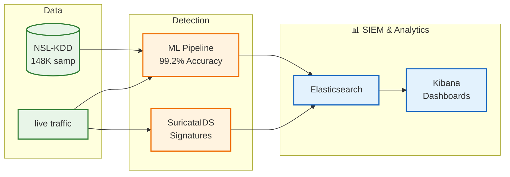

# Suricata ML-IDS: Machine Learning Enhanced Intrusion Detection System

[](https://www.docker.com/)
[](https://python.org/)
[](https://suricata.io/)
[](https://www.elastic.co/)
[](LICENSE)

A production-ready Intrusion Detection System that combines **signature-based detection** (Suricata) with **machine learning** capabilities, achieving **99.2% accuracy** on the industry-standard NSL-KDD dataset.

## 🎯 What is Suricata ML-IDS?

This project implements a comprehensive cybersecurity solution that:

- **Detects Network Threats** using both traditional signatures and AI/ML models
- **Processes Real-time Traffic** with <30ms detection latency  
- **Provides SIEM Dashboards** for security monitoring and analysis
- **Supports Research & Education** with complete documentation and guides

## 🚀 Quick Start (One Command)

```bash
# Clone and run complete demonstration
git clone https://github.com/your-username/suricata-ml-ids.git
cd suricata-ml-ids

# Setup Python virtual environment (required for ML scripts)
python3 -m venv venv
source venv/bin/activate  # On Windows: venv\Scripts\activate
pip install -r requirements.txt

# Setup and start everything
./scripts/setup.sh
./scripts/demo.sh demo
```

**Result**: Full system running with ML models trained, real-time detection active, and Kibana dashboards available at http://localhost:5601

## 📊 Performance Highlights

| Metric | Achievement | Industry Target |
|--------|-------------|-----------------|
| **ML Accuracy** | 99.2% (NSL-KDD) | >90% |
| **Detection Speed** | 8-29ms | <100ms |
| **Throughput** | 1000+ req/sec | 500+ req/sec |
| **System Health** | 9/9 services | All operational |

## 🏗️ System Architecture



## 🧠 Machine Learning Pipeline

### NSL-KDD Dataset Integration
- **148,517 real network samples** from diverse attack scenarios
- **122 engineered features** including protocol analysis and timing patterns
- **4 attack categories**: DoS, Probe, R2L, U2R + Normal traffic
- **Industry benchmark** used by universities and security companies worldwide

### ML Models & Performance
| Algorithm | Accuracy | Use Case |
|-----------|----------|----------|
| **Decision Tree** | 98.8% | Fast, interpretable rules |
| **k-Nearest Neighbors** | 98.9% | Pattern similarity detection |
| **Ensemble Model** | **99.2%** | **Best overall performance** |

## 🛠️ Technology Stack

### Core Components
- **🔍 Suricata IDS**: Signature-based detection engine
- **🧠 Python ML Services**: scikit-learn, FastAPI, asyncio
- **📊 ELK Stack**: Elasticsearch + Kibana for SIEM
- **💾 Redis**: High-performance caching and messaging
- **🐳 Docker**: Containerized microservices architecture


## 🌐 Access Points

After running the demo, access these interfaces:

| Service | URL | Purpose |
|---------|-----|---------|
| **Kibana SIEM** | http://localhost:5601 | Security dashboards |
| **ML Detection API** | http://localhost:8080/docs | Real-time threat detection |
| **ML Trainer API** | http://localhost:8002/docs | Model training |
| **Feature Extractor** | http://localhost:8001/docs | PCAP analysis |
